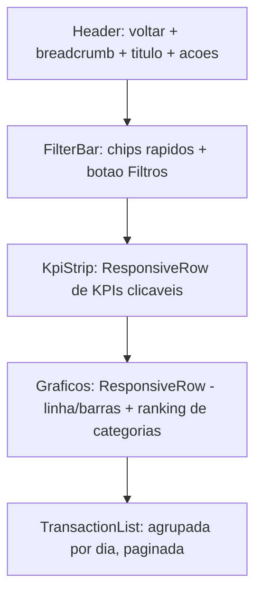
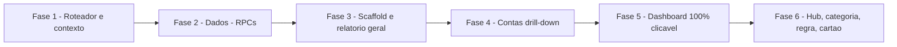

# Plano de Implementação — Navegação Clicável e Relatórios (DemBase · Flet 1.0.1)

> [!IMPORTANT]
> **Instruções para o agente executor:** leia [`regras_dembase.md`](file:///c:/Users/Denilson/Documents/GitHub/Dembase/regras_dembase.md) antes de tudo. Flet instalado = **1.0.1** (confirmado com `pip show flet`). Toda a comunicação com o banco fica **somente** em [`supabase_client.py`](file:///c:/Users/Denilson/Documents/GitHub/Dembase/dembase_flet/services/supabase_client.py); agregações pesadas ficam em **RPCs no PostgreSQL**. Cada fase termina com **testes no terminal** (seção 9). Comentários e textos sempre em PT-BR.
>
> **Status: APROVADO para execução.** Todas as decisões de produto já foram tomadas (seção 11). Execute as fases 1→6 em ordem, sem pular testes, e entregue conforme a **Definição de Pronto** (seção 12). Projeto ativo: `c:\Users\Denilson\Documents\GitHub\Dembase\dembase_flet` · Supabase: `ieljnrkxxopqzpnlodfk`.

---

## 0. Diagnóstico do estado atual (validado no código)

| # | Achado | Onde | Impacto |
|---|--------|------|---------|
| D1 | Os KPIs já chamam `navegar(page, "/relatorios?tipo=Receita")`, mas o roteador compara `rota == ROTA_RELATORIOS` (string exata). Com query string **não bate** e cai no *fallback* → volta ao Dashboard. | [dashboard_view.py#L312-L315](file:///c:/Users/Denilson/Documents/GitHub/Dembase/dembase_flet/views/dashboard_view.py#L312-L315), [router.py#L66-L163](file:///c:/Users/Denilson/Documents/GitHub/Dembase/dembase_flet/core/router.py#L66-L163) | **Hoje clicar em Receitas/Despesas "não faz nada".** |
| D2 | `on_route_change` sempre faz `page.views.clear()` + 1 view. Não existe pilha. | [router.py#L186-L190](file:///c:/Users/Denilson/Documents/GitHub/Dembase/dembase_flet/core/router.py#L186-L190) | Botão voltar do Android/navegador e seta "←" não funcionam em drill-down. |
| D3 | `ft.TemplateRoute` **não remove a query string**: testado `TemplateRoute("/contas/123?ini=...").match("/contas/:conta_id")` → `conta_id = "123?ini=2026-10-01&fim=..."`. | Flet 1.0.1 | É obrigatório separar path/query **antes** do match. |
| D4 | O período global já é persistido em sessão pelo Shell (`periodo_inicio`, `periodo_fim`, `periodo_mes`, `periodo_ano`, `periodo_modo`). | [shell_view.py#L78-L119](file:///c:/Users/Denilson/Documents/GitHub/Dembase/dembase_flet/views/shell_view.py#L78-L119) | Reaproveitar como fonte da verdade do período. |
| D5 | [relatorios_view.py](file:///c:/Users/Denilson/Documents/GitHub/Dembase/dembase_flet/views/relatorios_view.py) é monolítico (1262 linhas) e filtra em memória no Python. | — | Será quebrado em módulos e as agregações migradas para RPC. |

**APIs do Flet 1.0.1 confirmadas por introspecção:** `page.navigate(rota)` (síncrono, cria task de `push_route`), `await page.push_route(rota, **query)`, `page.views`, `page.on_route_change`, `page.on_view_pop`, `await page.pop_views_until(rota, result)`, `page.show_dialog` / `page.pop_dialog`, `page.run_task`, `ft.TemplateRoute`, `ft.View(route=, can_pop=, on_confirm_pop=, appbar=, ...)`. **NÃO existe `page.go()`** (legado 0.x — proibido).

---

## 1. Princípios de arquitetura

1. **URL = contrato.** Toda tela é endereçável por rota + query (`/contas/<id>?ini=2026-10-01&fim=2026-10-31`). Isso permite *deep link* no PWA, F5 sem perder contexto e botão voltar nativo.
2. **Pilha derivada da URL.** O roteador monta `page.views` a partir da hierarquia da rota (ex.: `/contas/abc` → `[Dashboard, Contas, Conta abc]`). Voltar = navegar para a rota da view anterior.
3. **Período: Sessão é a verdade; URL é a semente.** Ao abrir uma rota: `URL (ini/fim) > sessão > mês atual`. Ao mudar o período dentro de um relatório: atualiza a **sessão global** (mesmo período do Dashboard) e **recarrega in-place** (sem `navigate`, evitando loops e rebuild da pilha). Nenhum relatório guarda período próprio (decisão aprovada — seção 11).
4. **Relatórios plugáveis.** Cada relatório é um módulo que se registra num **catálogo** (`REPORTS`). Adicionar relatório novo = criar 1 arquivo + 1 entrada no registro, sem tocar no roteador.
5. **Um esqueleto visual para todos** (`ReportScaffold`): cabeçalho com breadcrumb/voltar → barra de filtros → KPIs → gráficos → lista de lançamentos. Consistência e menos código.
6. **Tudo clicável tem destino previsível** (mapa na seção 6) e feedback visual (`ink=True`, cursor, hover).

---

## 2. Estrutura de pastas (alvo)

```text
dembase_flet/
├── core/
│   ├── router.py              ← REESCRITO: tabela de rotas + parser + pilha
│   ├── nav.py                 ← NOVO: helpers de navegação tipados (ir_para_conta(...), etc.)
│   ├── report_context.py      ← NOVO: dataclass ReportContext (período + filtros) <-> query string
│   └── (demais arquivos inalterados)
├── services/
│   └── supabase_client.py     ← + funções de relatório (seção 7)
├── views/
│   ├── dashboard_view.py      ← KPIs e gráficos passam a usar core/nav.py
│   ├── contas_view.py         ← cada conta vira item clicável → /contas/<id>
│   ├── cartoes_view.py        ← cada cartão clicável → /cartoes/<id>
│   ├── relatorios/            ← NOVO PACOTE (substitui relatorios_view.py)
│   │   ├── __init__.py
│   │   ├── registry.py        ← catálogo REPORTS + decorator @registrar_relatorio
│   │   ├── hub_view.py        ← /relatorios  (grade de cards com todos os relatórios)
│   │   ├── lancamentos_report.py  ← /relatorios/lancamentos (Receitas/Despesas/Todos)
│   │   ├── conta_report.py        ← /contas/:conta_id
│   │   ├── cartao_report.py       ← /cartoes/:cartao_id  (fase 4)
│   │   ├── categoria_report.py    ← /relatorios/categoria/:categoria_id
│   │   ├── regra5030_report.py    ← /relatorios/regra/:regra
│   │   └── fluxo_mensal_report.py ← /relatorios/fluxo (balanço 6/12 meses)
│   └── widgets/
│       ├── clickable_card.py      ← NOVO: card clicável padrão (KPI/conta/cartão)
│       └── report/                ← NOVO: blocos do esqueleto
│           ├── scaffold.py        ← ReportScaffold
│           ├── header.py          ← breadcrumb + botão voltar + ações
│           ├── filter_bar.py      ← chips rápidos + bottom sheet de filtros avançados
│           ├── kpi_strip.py       ← faixa de KPIs (ResponsiveRow)
│           ├── transaction_list.py← lista paginada/lazy de lançamentos (clique = editar)
│           └── empty_state.py
└── migrations/
    └── 008_rpcs_relatorios.sql   ← NOVO
```

> [!NOTE]
> Manter `views/relatorios_view.py` como *shim* por uma fase (`from views.relatorios.hub_view import criar_view_hub as criar_view_relatorios`) para não quebrar imports existentes; remover na fase final.

---

## 3. Tabela de rotas (contrato)

| Rota (template) | Query aceita | Tela | Pai (para a pilha) |
|---|---|---|---|
| `/auth` | — | Login | — |
| `/dashboard` | — | Dashboard | — (raiz) |
| `/contas` | `ini, fim` | Lista de contas (clicáveis) | `/dashboard` |
| `/contas/:conta_id` | `ini, fim, tipo, cat, status, q` | **Relatório da conta** | `/contas` |
| `/cartoes` | — | Lista de cartões | `/dashboard` |
| `/cartoes/:cartao_id` | `ini, fim` / `fatura` | Relatório do cartão / faturas | `/cartoes` |
| `/relatorios` | `ini, fim` | Hub de relatórios | `/dashboard` |
| `/relatorios/lancamentos` | `tipo=Receita\|Despesa\|Transferencia\|Todos, ini, fim, conta, cat, sub, regra, status, forma, q` | **Relatório geral filtrado** | `/relatorios` (ou `/dashboard` se `origem=dashboard`) |
| `/relatorios/categoria/:categoria_id` | `tipo, ini, fim` | Relatório por categoria (+subcategorias) | `/relatorios` |
| `/relatorios/regra/:regra` | `ini, fim` | Despesas de uma faixa 50/30/20 | `/relatorios` |
| `/relatorios/fluxo` | `meses=6\|12` | Fluxo de caixa mensal | `/relatorios` |
| `/categorias`, `/calendario`, `/configuracoes`, `/lancamento` | — | (já existentes) | `/dashboard` |

**Regras de query (padronizar nomes curtos):** `ini`/`fim` em ISO `YYYY-MM-DD`; IDs em UUID; `regra` usa slug (`essencial`, `estilo-de-vida`, `investimento`) mapeado para o valor do enum; valores sempre via `urllib.parse.urlencode` / `parse_qs` (acentos e espaços seguros).

**Parâmetro `origem`** (opcional, ex.: `origem=dashboard`): define o pai na pilha quando o mesmo relatório pode ser aberto de lugares diferentes. Assim o "voltar" do relatório de Receitas aberto pelo KPI volta ao Dashboard, e não ao Hub.

---

## 4. Núcleo de navegação (core)

### 4.1 `core/report_context.py`

```text
@dataclass(frozen=True)
class ReportContext:
    data_inicio: date
    data_fim: date
    tipo: str | None = None          # Receita / Despesa / Transferencia / None(=todos)
    conta_id: str | None = None
    cartao_id: str | None = None
    categoria_id: str | None = None
    subcategoria_id: str | None = None
    regra: str | None = None
    status: str | None = None        # Pago / Pendente
    forma: str | None = None
    busca: str | None = None
    origem: str | None = None

    @classmethod from_query(params: dict, page) -> ReportContext   # URL > sessão > mês atual
    def to_query(self) -> dict                                     # só chaves não-nulas
    def com(**alteracoes) -> ReportContext                         # dataclasses.replace
    def to_rpc_filtros(self) -> dict                               # jsonb p/ RPC
```

- Validação defensiva: datas inválidas → cai na sessão; `fim < ini` → troca; UUID inválido → ignora o filtro (usar `uuid.UUID(...)` em try/except, igual a `_is_uuid` do form).
- Para ler a sessão, reutilizar [`obter_estado_periodo_atual`](file:///c:/Users/Denilson/Documents/GitHub/Dembase/dembase_flet/views/shell_view.py#L78) (mover a função para `core/` evitaria import de `views` dentro de `core` — **recomendado** mover `obter_estado_periodo_atual` e `_persistir_estado_periodo` para `core/periodo.py` e deixar *re-export* no shell).

### 4.2 `core/router.py` (reescrita)

**Parser obrigatório (resolve D1 e D3):**

```text
def separar_rota(rota_completa) -> (path, params):
    partes = urllib.parse.urlsplit(rota_completa or "/")
    path   = partes.path.rstrip("/") or "/"
    params = {k: v[0] for k, v in parse_qs(partes.query).items()}
```

**Tabela declarativa:**

```text
@dataclass
class RotaDef:
    template: str                    # "/contas/:conta_id"
    builder: Callable[[page, RouteMatch], ft.View]   # import lazy dentro do builder
    pai: str | Callable[[RouteMatch], str] | None    # rota do pai (para pilha)
    requer_login: bool = True

ROTAS: list[RotaDef] = [...]   # ordem: mais específicas primeiro
```

`RouteMatch` = `path`, `params_path` (dict do TemplateRoute), `query` (dict), `rota_completa`.

**Match:** `tr = ft.TemplateRoute(path)`; percorrer `ROTAS` e usar `tr.match(defn.template)`; parâmetros capturados lidos com `getattr(tr, nome)`. Rota desconhecida → `/dashboard` (logado) ou `/auth`.

**Montagem da pilha (resolve D2):**

```text
def montar_pilha(rota_completa) -> list[str]:
    cadeia = [rota_completa]
    while pai := resolver_pai(cadeia[0]):     # pai herda ini/fim da query atual
        cadeia.insert(0, pai)
    return cadeia                              # ex.: ["/dashboard", "/contas", "/contas/abc?ini=..."]
```

**on_route_change (síncrono, como hoje):**
1. Checagem de login (manter lógica atual de `_logado()`).
2. `pilha = montar_pilha(page.route)`.
3. **Reaproveitar views já existentes:** se `page.views[i].route == pilha[i]`, mantém a instância (não recarrega dados); reconstrói só a partir do primeiro índice divergente. Isso deixa o "voltar" instantâneo e preserva scroll do Dashboard.
4. `page.update()`.

**on_view_pop (botão voltar do Android / gesto iOS / seta do AppBar):**
```text
def on_view_pop(e: ft.ViewPopEvent):
    if len(page.views) > 1:
        page.views.pop()
        page.navigate(page.views[-1].route)   # route_change reaproveita a view (passo 3)
```
- A view raiz (`/dashboard`) deve ter `can_pop=False` para o Android não fechar o app no primeiro "voltar" sem querer (opcional: confirmar saída via `on_confirm_pop`).
- **Toda `ft.View` deve receber `route=` igual à rota completa usada na pilha** — é o que permite reaproveitar e `pop_views_until`.

**Rotas do Shell (sidebar):** clique na sidebar navega para rotas raiz (`/contas`, `/relatorios` ...) → pilha `[dashboard, X]`. Isso mantém o comportamento atual e ainda dá voltar para o Dashboard.

### 4.3 `core/nav.py` (helpers tipados — ninguém monta string de rota à mão)

```text
ir_dashboard(page)
ir_contas(page)
ir_conta(page, conta_id, ctx: ReportContext | None = None)
ir_cartao(page, cartao_id, ctx=None, fatura_id=None)
ir_relatorio_lancamentos(page, tipo=None, ctx=None, origem=None, **filtros)
ir_relatorio_categoria(page, categoria_id, tipo="Despesa", ctx=None)
ir_relatorio_regra(page, regra, ctx=None)
ir_hub_relatorios(page)
voltar(page)                         # = on_view_pop programático
```
Implementação: montar `path` + `urlencode(ctx.to_query() | extras)` e chamar `page.navigate(...)`. Período padrão = sessão atual (o mesmo que o Dashboard está exibindo).

---

## 5. Registro modular de relatórios

### 5.1 `views/relatorios/registry.py`

```text
@dataclass
class RelatorioDef:
    id: str                      # "lancamentos", "conta", "categoria"...
    titulo: str
    descricao: str
    icone: ft.IconData
    cor: str
    rota_template: str           # "/relatorios/lancamentos"
    pai: str                     # "/relatorios"
    builder: Callable[[ft.Page, RouteMatch, ReportContext], ft.View]
    no_hub: bool = True          # aparece na grade do Hub?
    rota_hub: str | None = None  # rota usada pelo card do Hub (ex.: com tipo=Despesa)

REPORTS: dict[str, RelatorioDef] = {}
def registrar_relatorio(defn): REPORTS[defn.id] = defn
```

- O `router.py` lê `REPORTS` e gera as `RotaDef` automaticamente → **relatório novo não exige editar o roteador**.
- Imports dos módulos de relatório feitos de forma lazy no `builder` (startup leve, padrão já usado no router atual).

### 5.2 Contrato de um relatório

Cada módulo expõe **uma** função `criar_view(page, match, ctx) -> ft.View` que:
1. Instancia um `ReportScaffold` com título, breadcrumb e os blocos desejados.
2. Define `carregar(ctx)` que chama **um** serviço do `supabase_client` (uma RPC) e preenche os blocos.
3. Retorna `criar_shell(page, rota_ativa=<rota raiz do menu>, conteudo=scaffold, on_periodo_change=...)` envolto numa `ft.View(route=match.rota_completa, ...)` (ver 5.3).

### 5.3 Shell em telas de detalhe

[`criar_shell`](file:///c:/Users/Denilson/Documents/GitHub/Dembase/dembase_flet/views/shell_view.py#L122) ganha 3 parâmetros opcionais:
- `rota_view: str` → usado em `ft.View(route=...)` (hoje provavelmente usa `rota_ativa`; precisa ser a rota completa da pilha).
- `titulo: str | None` → substitui "Dashboard" no header.
- `mostrar_voltar: bool` → exibe `IconButton(ARROW_BACK_ROUNDED)` à esquerda do título (chama `nav.voltar`). No mobile substitui o hambúrguer; no desktop fica ao lado do título.
- `rota_ativa` continua indicando o item destacado na sidebar (ex.: `/contas/abc` destaca "Contas").

O filtro de período do header **continua global**: no relatório, `on_periodo_change` → `carregar(ctx.com(data_inicio=..., data_fim=...))` in-place.

---

## 6. Mapa de cliques (o app "totalmente clicável")

| Origem | Elemento | Destino |
|---|---|---|
| Dashboard | KPI **Saldo em Conta** | `/contas` |
| Dashboard | KPI **Receitas** | `/relatorios/lancamentos?tipo=Receita&ini&fim&origem=dashboard` |
| Dashboard | KPI **Despesas** | `/relatorios/lancamentos?tipo=Despesa&ini&fim&origem=dashboard` |
| Dashboard | KPI **Faturas Abertas** | `/cartoes` |
| Dashboard | Linha **Essencial / Estilo de Vida / Investimento** (Regra 50/30/20) | `/relatorios/regra/<slug>?ini&fim` |
| Dashboard | Fatia/linha de **Despesas por Categoria** | `/relatorios/categoria/<id>?tipo=Despesa&ini&fim` |
| Dashboard | Fatia/linha de **Receitas por Categoria** | `/relatorios/categoria/<id>?tipo=Receita&ini&fim` |
| Dashboard | Barra de um mês no **Balanço 6 meses** | `/relatorios/lancamentos?ini=<1º dia>&fim=<último dia>` |
| Dashboard | Dia no gráfico de **Frequência** | `/relatorios/lancamentos?ini=<dia>&fim=<dia>` |
| Dashboard | Cartão no resumo de cartões | `/cartoes/<id>` |
| `/contas` | Card de uma conta | `/contas/<id>?ini&fim` (botões editar/excluir ficam num menu `⋮` para não competir com o clique do card) |
| `/cartoes` | Card de um cartão | `/cartoes/<id>` |
| Qualquer relatório | KPI interno (ex.: "Entradas" no relatório da conta) | aplica filtro `tipo` **in-place** (sem navegar) |
| Qualquer relatório | Linha de categoria no ranking | `/relatorios/categoria/<id>` com o mesmo período e conta |
| Qualquer relatório | Linha de lançamento | abre `abrir_lancamento(page, lancamento=item, on_saved=recarregar)` (modal existente) |
| Hub `/relatorios` | Card de cada relatório | `rota_hub` do `RelatorioDef` |

**Implementação dos gráficos clicáveis** em [dashboard_charts.py](file:///c:/Users/Denilson/Documents/GitHub/Dembase/dembase_flet/views/widgets/dashboard_charts.py): a forma mais robusta e multiplataforma é tornar clicáveis as **legendas/linhas** (Containers com `on_click` + `ink=True`). Eventos de toque nas fatias/barras dos charts são opcionais (só se o controle de gráfico usado expuser evento estável no 1.0.1 — o executor deve verificar por introspecção antes; se não houver, apenas legendas clicáveis). `construir_grid_graficos` passa a receber um `on_drill: Callable[[str, dict], None]` (ex.: `on_drill("categoria", {"id": ..., "tipo": "Despesa"})`) para o widget não conhecer rotas.

### 6.1 `views/widgets/clickable_card.py`

Componente padrão para qualquer card clicável:
- `ft.Container(on_click=..., ink=True, border_radius=14, ...)`, `on_hover` alterando borda/elevação no desktop, `tooltip` opcional.
- Ícone `CHEVRON_RIGHT_ROUNDED` discreto no canto, indicando que é navegável (affordance mobile).
- Área mínima de toque **48 px** de altura.
- O `_kpi` do Dashboard ([dashboard_view.py#L270](file:///c:/Users/Denilson/Documents/GitHub/Dembase/dembase_flet/views/dashboard_view.py#L270)) passa a usar este componente.

---

## 7. Camada de dados (Supabase)

### 7.1 Migration `008_rpcs_relatorios.sql`

Todas `SECURITY DEFINER`, `SET search_path TO 'public'`, filtrando **sempre** por `user_id = auth.uid()`.

**a) `get_relatorio_lancamentos(p_data_inicio date, p_data_fim date, p_filtros jsonb DEFAULT '{}', p_limite int DEFAULT 50, p_offset int DEFAULT 0) RETURNS jsonb`**
Filtros aceitos em `p_filtros`: `tipo, conta_id, cartao_id, categoria_id, subcategoria_id, regra, status, forma, busca (ILIKE em descricao/subtipo)`. **Se `tipo` for nulo ou `Todos`, excluir `Transferência`** (decisão aprovada). Retorno:
```json
{
  "totais": {"receitas": 0, "despesas": 0, "saldo": 0, "qtd": 0, "pago": 0, "pendente": 0, "media_diaria": 0},
  "por_categoria": [{"categoria_id": "", "nome": "", "cor": "", "icone": "", "total": 0, "percentual": 0, "qtd": 0}],
  "por_dia": [{"data": "2026-10-01", "receitas": 0, "despesas": 0}],
  "por_forma": [{"forma": "Pix", "total": 0}],
  "lancamentos": [ {...linha com nomes de conta/categoria/cartão já resolvidos...} ],
  "total_registros": 0
}
```

**b) `get_relatorio_conta(p_conta_id uuid, p_data_inicio date, p_data_fim date, p_filtros jsonb DEFAULT '{}', p_limite int DEFAULT 50, p_offset int DEFAULT 0) RETURNS jsonb`**
- Considera lançamentos com `conta_id = p_conta_id` **e** transferências recebidas (`destino_id = p_conta_id`, entram como entrada). Aqui as transferências **sempre** aparecem (afetam o saldo).
- Somente status `Pago` afeta saldo realizado; pendentes vão para "previsto".
- Retorno: `conta {id, nome, cor, icone, tipo_conta, saldo_atual}`, `saldo_inicial` (saldo no dia anterior a `p_data_inicio`), `entradas`, `saidas`, `saldo_final`, `saldo_previsto_fim`, `evolucao_saldo [{data, saldo}]` (saldo acumulado dia a dia — ótimo para gráfico de linha), `por_categoria`, `lancamentos`, `total_registros`.

**c) `get_lista_contas_resumo(p_data_inicio date, p_data_fim date) RETURNS jsonb`**
Para a tela `/contas` mostrar, por conta: `saldo_atual`, `saldo_previsto`, `entradas_periodo`, `saidas_periodo`, `qtd_lancamentos_periodo` (mini-indicadores no card).

**d) (fase 4) `get_relatorio_cartao(p_cartao_id, p_data_inicio, p_data_fim)`** — faturas, limite usado, compras por categoria, parcelas futuras.

**Índices recomendados:** `lancamentos (user_id, data)`, `lancamentos (user_id, conta_id, data)`, `lancamentos (user_id, destino_id, data) WHERE destino_id IS NOT NULL`, `lancamentos (user_id, categoria_id, data)` (criar com `IF NOT EXISTS`).

> [!WARNING]
> Lição da correção anterior (erro `42P10`): ao usar `ON CONFLICT` com índice parcial, repetir o `WHERE` do índice. Nos casts de enum (`status_lancamento`, `regra_financeira`) usar `NULLIF(...,'')` antes do cast para não estourar com string vazia vinda do front.

### 7.2 Serviços em `supabase_client.py`

```text
obter_relatorio_lancamentos(data_inicio, data_fim, filtros=None, limite=50, offset=0) -> dict
obter_relatorio_conta(conta_id, data_inicio, data_fim, filtros=None, limite=50, offset=0) -> dict
obter_lista_contas_resumo(data_inicio, data_fim) -> dict
obter_relatorio_cartao(cartao_id, data_inicio, data_fim) -> dict      # fase 4
```
Sempre retornar estrutura vazia válida (`resp.data or {...}`) para a UI nunca quebrar com `None`.

---

## 8. Estrutura visual dos componentes

### 8.1 `ReportScaffold` (layout comum)



| Bloco | Mobile (`is_mobile`) | Desktop |
|---|---|---|
| **Header** | Seta voltar no lugar do hambúrguer; título 1 linha com elipse; breadcrumb oculto | Breadcrumb clicável `Dashboard › Contas › Nubank` (cada parte navega) |
| **Ações do header** | Slot `acoes_header` (ex.: "+ Lançamento"). **Sem exportação no MVP.** | Idem |
| **FilterBar** | `Row(scroll=ft.ScrollMode.AUTO)` com chips: `Todos · Receitas · Despesas · Transferências · Pagos · Pendentes` (*Todos* = receitas + despesas, **sem** transferências) + chip **"Filtros (n)"** que abre `BottomSheet(scrollable=True)` com conta, categoria, subcategoria, forma, regra, busca | Chips + Dropdowns inline (`on_select`) + `TextField` de busca com debounce |
| **KpiStrip** | `ResponsiveRow`, `col={"xs": 6, "md": 3}` (grade 2×2) | 1×4 |
| **Gráficos** | 1 coluna (`col={"xs": 12, "md": 6}`) | 2 colunas |
| **TransactionList** | `ListView` com cabeçalho por dia ("Seg, 20 out · −R$ 120,00"), item de 64 px: ícone categoria, descrição, conta, valor colorido, badge status | Mesma lista em card largo (evitar `DataTable` no mobile — estoura largura) |
| **Paginação** | Botão "Carregar mais" no fim (offset += 50) | Idem |
| **Estados** | `ProgressRing` no header durante `carregar`; `EmptyState` com ícone + texto + botão "Novo lançamento" | Idem |

**Filtros ativos visíveis:** abaixo da FilterBar, chips removíveis (`Conta: Nubank ✕`) — clicar no ✕ remove o filtro in-place.

### 8.2 Relatório geral (`/relatorios/lancamentos`)
- Título dinâmico: "Receitas", "Despesas" ou "Lançamentos".
- KPIs: **Total**, **Pago/Recebido**, **Pendente**, **Média diária**.
- Gráficos: evolução diária (barras), ranking de categorias (lista com barra de progresso + % — **cada linha clicável** → relatório da categoria).
- Lista de lançamentos.

### 8.3 Lista de contas (`/contas`)
- Card de cabeçalho: **Saldo total atual** e **Saldo previsto**.
- Cards de conta (`ResponsiveRow`, `col={"xs":12,"sm":6,"lg":4}`): ícone/cor da conta, nome, saldo atual, mini-linha "↑ entradas · ↓ saídas no período", chevron. Card inteiro clicável → `/contas/<id>`. Ações editar/excluir no `PopupMenuButton` (o clique no menu **não** deve propagar para o card — colocar o menu fora da área do `on_click`, p. ex. card = `Stack`/`Row` com Container clicável + menu separado).

### 8.4 Relatório da conta (`/contas/:conta_id`)
- Hero com cor da conta: nome, tipo, **saldo atual**.
- KPIs: **Saldo inicial do período**, **Entradas**, **Saídas**, **Saldo final** (Entradas/Saídas clicáveis → filtra `tipo` in-place).
- Gráfico de linha: **evolução do saldo** no período.
- Ranking de categorias da conta.
- Lista de lançamentos da conta (inclui transferências de entrada/saída com ícone `SWAP_HORIZ`).
- Ação no header: **"+ Lançamento nesta conta"** → `abrir_lancamento` com `conta_id` pré-selecionado (exige pequeno parâmetro novo `conta_inicial` em [`abrir_lancamento`](file:///c:/Users/Denilson/Documents/GitHub/Dembase/dembase_flet/views/widgets/lancamento_sheet.py#L26)).

### 8.5 Hub (`/relatorios`)
Grade de `clickable_card` gerada a partir de `REPORTS` (`no_hub=True`): Receitas, Despesas, Fluxo mensal, Regra 50/30/20, Por categoria, Contas, Cartões. Novos relatórios aparecem automaticamente.

---

## 9. Plano de execução em fases (com critérios de aceite)



### Fase 1 — Roteador, pilha e contexto
- Criar `core/periodo.py`, `core/report_context.py`, `core/nav.py`; reescrever `core/router.py` (seção 4).
- Ajustar `criar_shell` (`rota_view`, `titulo`, `mostrar_voltar`).
- **Testes de terminal obrigatórios:**
  - `separar_rota("/contas/abc?ini=2026-10-01&fim=2026-10-31")` → path `/contas/abc`, params corretos.
  - Match de todas as rotas da tabela (incluindo com e sem query, com barra final).
  - `montar_pilha("/contas/<uuid>?ini=..")` → `["/dashboard", "/contas?ini=..", "/contas/<uuid>?ini=.."]`.
  - `montar_pilha("/relatorios/lancamentos?tipo=Receita&origem=dashboard")` → pai = `/dashboard`.
  - `ReportContext.from_query` com datas inválidas / UUID inválido / `fim<ini`.
  - Rota desconhecida → fallback correto.
- **Aceite:** todas as rotas antigas continuam abrindo; botão voltar funciona em `/contas`.

### Fase 2 — RPCs e serviços
- Migration `008_rpcs_relatorios.sql` + funções em `supabase_client.py`.
- **Testes:** executar cada RPC em bloco `BEGIN; ... ROLLBACK;` no Supabase com dados inseridos de teste (receita, despesa, transferência entre contas, pendente futuro) e conferir totais, `saldo_inicial + entradas − saídas = saldo_final`, paginação e filtros.

### Fase 3 — Scaffold + Relatório geral
- `widgets/report/*`, `relatorios/registry.py`, `relatorios/lancamentos_report.py`.
- **Aceite:** clicar KPI Receitas/Despesas abre o relatório com o **mesmo período** do Dashboard; trocar período no header recarrega in-place; chips filtram; clicar lançamento abre modal de edição e, ao salvar, a lista recarrega.

### Fase 4 — Contas (drill-down)
- Refatorar [contas_view.py](file:///c:/Users/Denilson/Documents/GitHub/Dembase/dembase_flet/views/contas_view.py) para cards clicáveis + `relatorios/conta_report.py`.
- **Aceite:** Dashboard → Saldo em Conta → Lista → Conta X → relatório só da conta X → voltar → voltar → Dashboard (sem recarregar o Dashboard, graças ao reaproveitamento de views).

### Fase 5 — Dashboard 100% clicável
- `clickable_card` nos KPIs; `on_drill` em `construir_grid_graficos` (Regra 50/30/20, categorias, balanço 6m, frequência, cartões).

### Fase 6 — Hub e relatórios adicionais
- `hub_view.py`, `categoria_report.py`, `regra5030_report.py`, `fluxo_mensal_report.py`, `cartao_report.py`; remover shim `relatorios_view.py`.
- **Fora do escopo (MVP):** exportação CSV/PDF.

---

## 10. Checklist Flet 1.0.1 (validar em todo arquivo novo)

| ✅ Usar | ❌ Nunca usar (legado) |
|---|---|
| `page.navigate("/rota?x=1")` em callbacks síncronos; `await page.push_route(...)` em async | `page.go(...)` |
| `ft.View(route=<rota completa>, controls=[...], can_pop=...)` | View sem `route` |
| `page.show_dialog(dlg)` / `page.pop_dialog()` | `page.dialog = ...`, `page.open()`, `dlg.open = True` como mecanismo principal |
| `ft.Colors.X`, `ft.Icons.X` (maiúsculo, ex.: `ft.Colors.WHITE_70`) | `ft.colors`, `ft.icons`, `WHITE70` |
| `Dropdown(on_select=...)` e ler `e.data or e.control.value` | `Dropdown(on_change=...)` |
| `SegmentedButton(selected=[...])` (lista) | `selected={...}` (set) |
| `Container(on_click=..., ink=True)` para cards clicáveis | `GestureDetector` só para clique simples |
| `BottomSheet(scrollable=True)` no mobile | BottomSheet sem scroll (corta conteúdo) |
| Separar query com `urllib.parse.urlsplit` **antes** de `ft.TemplateRoute.match` | Passar a rota com query direto ao `TemplateRoute` |
| `ft.run(main)` + `async def main` | `ft.app(target=main)` |
| `ResponsiveRow` + `col={"xs":..,"md":..}` | Larguras fixas em px para layout |

> [!TIP]
> **Teste padrão de UI no terminal** (já usado com sucesso neste projeto): montar a view com uma `DummyPage` (com `width`, `height`, `views`, `show_dialog`, `pop_dialog`, `navigate` registrando a rota), mockar as funções do `supabase_client`, e serializar com `from flet.controls.object_patch import ObjectPatch; ObjectPatch.from_diff({}, view, control_cls=ft.Control)` para garantir que nenhum atributo inválido quebre a renderização. Simular cliques chamando `controle.on_click(None)` e verificar a rota registrada.

---

## 11. Decisões aprovadas pelo usuário (definitivas — não perguntar de novo)

| # | Decisão | Como implementar |
|---|---------|------------------|
| 1 | **Transferências ficam ocultas por padrão** no relatório geral. | Em `get_relatorio_lancamentos`, quando `p_filtros->>'tipo'` for nulo/`Todos`, excluir `tipo = 'Transferência'`. Elas só aparecem com o chip **"Transferências"** (`tipo=Transferencia`). **Exceção:** no relatório da conta (`/contas/:conta_id`) as transferências **sempre** aparecem, pois afetam o saldo da conta. |
| 2 | **Período sempre segue o filtro global do Dashboard.** | Fonte da verdade = sessão (`core/periodo.py`). Ao abrir qualquer relatório: `URL (ini/fim) > sessão > mês atual`. Trocar o período dentro de um relatório atualiza a **sessão global** (o Dashboard e os demais relatórios passam a usar o novo período). Nenhum relatório guarda período próprio. |
| 3 | **Exportação CSV/PDF fora do MVP.** | **Não implementar** nada de exportação. Não criar botões, menus ou placeholders de "Exportar". Apenas manter o `ReportScaffold` com um slot `acoes_header: list[ft.Control]` para isso poder ser adicionado no futuro sem refatorar. |

---

## 12. Definição de pronto (entrega final do agente executor)

- [ ] Todas as fases 1–6 implementadas, com os testes de terminal de cada fase executados e passando (colar a saída no resumo final).
- [ ] `python -c "import main"` e import de todos os módulos de `views/relatorios/` sem erro.
- [ ] Varredura AST confirmando que não há atributos `ft.*` inexistentes no Flet 1.0.1 (mesmo método já usado no projeto) e nenhum uso de `page.go`, `ft.app(`, `ft.colors.`, `ft.icons.`.
- [ ] Serialização com `ObjectPatch.from_diff` de **todas** as views novas (mobile `width=390` e desktop `width=1280`) sem exceção.
- [ ] Fluxos simulados com `DummyPage` verificando a rota navegada:
  - Dashboard → KPI Receitas → `/relatorios/lancamentos?tipo=Receita&ini=..&fim=..&origem=dashboard` → voltar → `/dashboard`.
  - Dashboard → KPI Saldo em Conta → `/contas` → card da conta → `/contas/<id>?ini=..&fim=..` → voltar → `/contas` → voltar → `/dashboard`.
  - Linha de categoria / Regra 50/30/20 / barra do balanço 6m levam às rotas da seção 6.
- [ ] RPCs da migration 008 aplicadas no Supabase (projeto `ieljnrkxxopqzpnlodfk`) e testadas em `BEGIN ... ROLLBACK`.
- [ ] Arquivo [`regras_dembase.md`](file:///c:/Users/Denilson/Documents/GitHub/Dembase/regras_dembase.md) atualizado na seção 5 (Arquitetura) com `core/nav.py`, `core/report_context.py`, `core/periodo.py`, `views/relatorios/` e `views/widgets/report/`.
- [ ] Resumo final em PT-BR com a lista de arquivos criados/alterados (links clicáveis).
